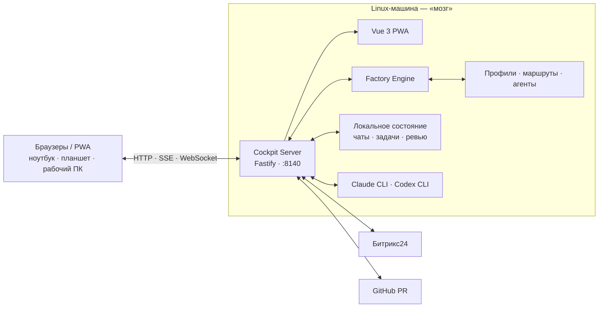

<h1 align="center">🛩️ AI Cockpit</h1>

<p align="center"><strong>Локальный пульт управления задачами, ИИ-агентами и конвейерами разработки.</strong></p>

<p align="center">Битрикс24 · Claude и Codex · Factory Engine · GitHub PR · Vue 3 · Fastify</p>

<p align="center">
  <a href="#возможности">Возможности</a> ·
  <a href="#архитектура">Архитектура</a> ·
  <a href="#быстрый-старт">Быстрый старт</a> ·
  <a href="#проверки">Проверки</a>
</p>

## Зачем

AI Cockpit объединяет повседневную работу в одном интерфейсе: показывает задачи Битрикс24, запускает их по агентным маршрутам, следит за состоянием стендов, даёт несколько параллельных чатов с CLI-агентами и помогает разбирать GitHub PR.

Основная модель — **один «мозг» и несколько окон**:

- домашний Linux-компьютер запускает сервер, CLI-агентов и Factory Engine;
- сервер работает host-native, читает локальное состояние и управляет процессами;
- ноутбук, рабочий компьютер и планшет подключаются как браузерные окна через доверенную сеть;
- PWA, API, SSE и веб-терминал в production обслуживаются с одного origin.

## Возможности

| Раздел | Что умеет |
|---|---|
| **Доска** | Показывает задачи, показатели и таймеры Битрикс24, триаж-оценки, избранное и запуск на конвейер. |
| **Конвейер** | Визуализирует живой граф стадий, прогресс, ожидания человека, failover исполнителей, возвраты и стенды. |
| **Чаты** | Ведёт параллельные сессии Claude и Codex с вложениями, диктовкой, разрешениями, очередью ходов и потоковой лентой действий. |
| **Ревью PR** | Синхронизирует замечания GitHub, анализирует и переводит их; контур автоматического исправления пока работает в fail-closed режиме. |
| **Агенты и маршруты** | Позволяет редактировать стадии, промпты и проектные маршруты без правок движка. |
| **Проекты и код** | Управляет рабочими проектами, показывает ветки, файлы и diff. |
| **Видео** | Превращает запись встречи в транскрипт и черновики задач Битрикс24. |
| **Терминал** | Даёт PTY в браузере для авторизации CLI и ручных операций на машине-мозге. |

## Архитектура



В production сервер сам отдаёт собранный интерфейс. В режиме разработки Vite работает на `:5180`, а API — на `:8140`.

## Быстрый старт

### Требования

| Что | Требование | Для чего |
|---|---|---|
| Linux | systemd user для production | Host-native сервер и управление процессами |
| Node.js | **22+** | Fastify, Vite и встроенная загрузка `.env` |
| npm, bash, git | актуальные версии | Зависимости, скрипты и worktree задач |
| `script` из util-linux | установлен | PTY веб-терминала без нативного `node-pty` |
| `ss` и `ip` из iproute2 | установлены | Проверка порта и VPN-маршрута |

Опциональные интеграции:

- `claude` и/или `codex` CLI — чаты и стадии фабрики;
- `gh` CLI — экспериментальное автоматическое ревью GitHub PR;
- `ffmpeg`, `ffprobe` и Python-venv с `faster-whisper` — видео и диктовка;
- доступ к Битрикс24 — доска, карточки задач и создание черновиков;
- туннель `singbox_tun` — production-ворота для исходящего трафика.

> [!TIP]
> systemd не видит PATH из `nvm`. `deploy/install.sh` записывает абсолютный путь к текущему Node.js; после переключения версии Node запустите установщик повторно.

### Локальный запуск

```bash
git clone git@github.com:EvilDevRu/ai-cockpit.git
cd ai-cockpit
cp .env.example .env

bin/cockpit deps       # установить зависимости server/ и web/
bin/cockpit dev        # Vite с hot reload + API-сервер
```

Обычный запуск с production-сборкой интерфейса:

```bash
bin/cockpit            # собрать web и запустить сервер на :8140
bin/cockpit build      # только собрать web
bin/restart            # безопасно перезапустить ручной экземпляр и проверить health
```

> [!WARNING]
> `bin/restart` предназначен только для ручной разработки. Перед ним остановите production-юнит командой `systemctl --user stop cockpit-server`, иначе два владельца будут бороться за порт `8140`. Диагностика описана в [docs/cockpit/gotchas.md](docs/cockpit/gotchas.md).

### Production

```bash
deploy/install.sh

systemctl --user status cockpit-server
journalctl --user -u cockpit-server -f
```

Установщик ставит зависимости, собирает PWA, создаёт systemd user-юнит и добавляет CLI `b24` в PATH. После запуска интерфейс доступен на `http://localhost:8140`; внешний доступ настраивается отдельно.

> [!IMPORTANT]
> Production-юнит стартует только при активном VPN-маршруте через `singbox_tun`. Пока туннеля нет, systemd оставляет сервис в `activating (auto-restart)` и пишет понятную причину в журнал; после появления VPN Кокпит поднимется сам.

## Конфигурация и данные

Корневой `.env` создаётся из [.env.example](.env.example). Все машинно-зависимые значения собраны в [server/src/config.js](server/src/config.js).

Чаще всего нужны:

- `COCKPIT_PORT` и `COCKPIT_HOST`;
- `COCKPIT_CLAUDE_BIN` и `COCKPIT_CODEX_BIN`;
- `COCKPIT_MEDIA_PYTHON`;
- `COCKPIT_ANALYSIS_CONCURRENCY`;
- `COCKPIT_DISCOVER_WITH_CLI_TOKEN`;
- `COCKPIT_TASK_FAVORITES_PATH`.

Встроенный движок берётся из `engine/`, а профили — из локального `profiles/`. Переменные `FACTORY_HOME`, `FACTORY_PROFILES_DIR` и `COCKPIT_FACTORY_BIN` нужны только для осознанной внешней раскладки.

> [!CAUTION]
> Не коммитьте `.env`, `profiles/` и `server/.state/`: там находятся машинные пути, настройки проектов, сессии, токены, cookies и другие приватные данные. Эти каталоги уже исключены из Git.

## Структура репозитория

| Путь | Назначение |
|---|---|
| `server/` | Fastify API и модули Cockpit; LLM-исполнители находятся в `server/src/lib/executors/`. |
| `web/` | Vue 3 + Vite PWA, которую в production отдаёт сервер. |
| `engine/` | Независимый от проектов движок фабрики и его CLI. |
| `profiles/` | Локальные профили проектов: policy, graph, env и скрипты; каталог не коммитится. |
| `agents/` | Редактируемая база агентных стадий и промптов. |
| `routes/` | Маршруты конвейера и сайдкары промптов отдельных узлов. |
| `chats/` | История чатов, разделённая по файлам и месяцам. |
| `docs/` | Архитектура, контракты подсистем и эксплуатационные заметки. |
| `tests/` | Общий тестовый контур документации, движка, сервера и интерфейса. |
| `bin/` | Команды запуска, перезапуска и работы с Битрикс24. |
| `deploy/` | systemd user-юнит, установщик и VPN-ворота. |

## Проверки

Полный офлайн-прогон:

```bash
bash tests/run-all.sh
```

Быстрые проверки отдельных слоёв:

```bash
(cd server && npm test)
(cd web && npm test)
(cd web && npm run build)
```

## Документация

- [docs/README.md](docs/README.md) — карта всей документации;
- [docs/cockpit/architecture.md](docs/cockpit/architecture.md) — устройство сервера и модулей;
- [docs/cockpit/chat-agents.md](docs/cockpit/chat-agents.md) — чаты, исполнители, разрешения и поток шагов;
- [docs/cockpit/factory-graph.md](docs/cockpit/factory-graph.md) — граф конвейера и его состояния;
- [docs/cockpit/gotchas.md](docs/cockpit/gotchas.md) — эксплуатационные грабли и диагностика;
- [docs/engine/ENGINE.md](docs/engine/ENGINE.md) — устройство Factory Engine;
- [tests/README.md](tests/README.md) — тестовые уровни и команды.
