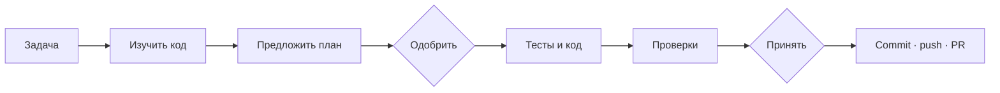

<p align="center">
  
</p>

<h1 align="center">AI Cockpit</h1>

<p align="center"><strong>Один интерфейс для задач, ИИ-агентов и автоматической разработки.</strong></p>

<p align="center">
  <a href="https://github.com/EvilDevRu/ai-cockpit/releases/latest">
    
  </a>
</p>

<p align="center">
  <code>Local-first</code> · <code>PWA</code> · <code>Claude</code> ·
  <code>GPT / Codex</code> · <code>Kimi Code</code>
</p>

<p align="center">
  <a href="#что-это">Что это</a> ·
  <a href="#возможности">Возможности</a> ·
  <a href="#ии-и-модели">ИИ и модели</a> ·
  <a href="#установка">Установка</a>
</p>

---

## Что это

AI Cockpit — веб-пульт для разработки с ИИ на собственной Linux-машине. Его можно открыть
с компьютера или планшета, вести несколько чатов с агентами, запускать задачи в работу и
видеть, что происходит на каждом этапе.

Вместо одного длинного запроса задача проходит понятный маршрут: ИИ изучает код, предлагает
план, пишет тесты и реализацию, запускает проверки и готовит Pull Request. В важных местах
Cockpit останавливается и просит решение человека.

## Возможности

| | |
|---|---|
| **💬 Чаты с несколькими ИИ**<br><br>Claude, GPT/Codex и Kimi в одном интерфейсе. Параллельные разговоры, файлы, голосовой ввод, история, остановка хода и выбор уровня рассуждения. | **🧭 Конвейер разработки**<br><br>Задача движется по видимым этапам: анализ, план, тесты, код, проверки и публикация. Упавший прогон можно продолжить с места остановки. |
| **🙋 Человек остаётся главным**<br><br>Планы и результат требуют одобрения. Cockpit сообщает, когда агент задал вопрос, ждёт разрешения, замолчал или столкнулся с ошибкой. | **🗂️ Код и проекты**<br><br>Несколько проектов и репозиториев, дерево файлов, просмотр кода и diff. Markdown-документы открываются прямо в Cockpit. |
| **📋 Битрикс24**<br><br>Доска задач, таймеры, показатели, избранное, ИИ-триаж и запуск задачи на конвейер. Запись встречи можно превратить в транскрипт и черновики задач. | **🛠️ Пульт машины**<br><br>Веб-терминал, PWA, уведомления, плагины, обновление Cockpit и ИИ-инструментов, локальный HTTPS для планшета и компьютеров в домашней сети. |

## ИИ и модели

| Исполнитель | Доступные модели |
|---|---|
| **Claude** · Anthropic | Opus 5, Opus 5 (1M), Fable 5, Sonnet 5, Haiku 4.5 |
| **GPT (Codex)** · OpenAI | GPT-5.6 Sol, Terra и Luna, GPT-5.5, GPT-5.3 Codex Spark |
| **Kimi Code** · Moonshot AI | K3 (1M), K3-256K, K2.7 Coding и Highspeed |

Список не зашит в интерфейс навсегда: Claude и Codex читают модели из установленного CLI
и доступов аккаунта. Старые модели можно показать отдельным переключателем. Kimi запускается
в изолированном окружении с ограниченным доступом к системе и сети.

## Как проходит задача



Человек видит активный этап, действия агента, выбранную модель и результаты проверок.
Отклонённый план или результат возвращается на нужный этап с комментарием.

## Как устроено

Cockpit работает на одной Linux-машине — «мозге». Там находятся код, CLI-агенты, история
чатов и состояние задач. Остальные устройства подключаются к ней через браузер. Сервер написан
на Fastify, интерфейс — на Vue 3, конвейером управляет независимый Factory Engine.

## Установка

Production-установка рассчитана на Linux с Node.js 22+, npm, bash, git и systemd. Для работы
с ИИ установите и авторизуйте хотя бы один CLI: `claude`, `codex` или `kimi`.

```bash
git clone git@github.com:EvilDevRu/ai-cockpit.git
cd ai-cockpit
cp .env.example .env
deploy/install.sh
systemctl --user status cockpit-server
```

После запуска Cockpit доступен на `http://localhost:8140`. Битрикс24, распознавание видео
и удалённый доступ подключаются отдельно — базовый интерфейс от них не зависит.

> [!CAUTION]
> Не коммитьте `.env`, `profiles/` и `server/.state/`: в них находятся локальные пути,
> настройки проектов, сессии и секреты. Эти каталоги уже исключены из Git.

## Документация

- [Карта документации](docs/README.md)
- [Чаты, модели и разрешения](docs/cockpit/chat-agents.md)
- [Конвейер и состояния задач](docs/cockpit/factory-graph.md)
- [Устройство Factory Engine](docs/engine/ENGINE.md)
- [Подключение нового проекта](docs/engine/NEW-PROJECT.md)
- [Эксплуатация и диагностика](docs/cockpit/gotchas.md)

Полная проверка проекта: `bash tests/run-all.sh`.
