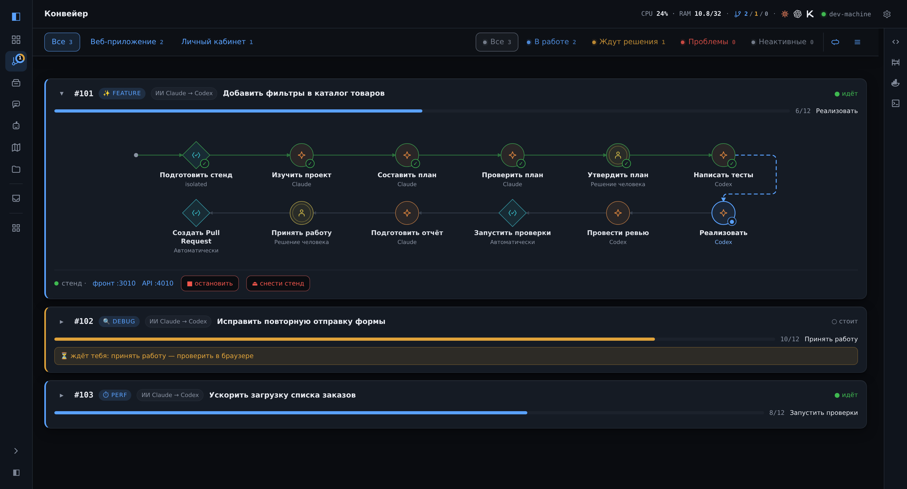

<p align="center">
  
</p>

<h1 align="center">AI Cockpit</h1>

<p align="center"><strong>ИИ делает задачу по шагам. Вы видите весь конвейер и принимаете результат.</strong></p>

<p align="center">
  <a href="#установка">
    
  </a>
</p>

<p align="center">
  <a href="#конвейеры">Конвейеры</a> ·
  <a href="#песочницы-и-изолированные-стенды">Песочницы</a> ·
  <a href="#что-ещё-под-рукой">Что ещё под рукой</a> ·
  <a href="#установка">Установка</a>
</p>

---

Кокпит помогает доводить задачи до рабочего кода с помощью ИИ-агентов. Вы описываете,
что должно получиться, а конвейер ведёт работу по этапам: изучить проект, подготовить план,
внести изменения и проверить результат.

На одной странице видно, какие задачи выполняются, до какого этапа дошла каждая и где нужен
ваш ответ. Можно вести несколько задач и проектов параллельно. Сам Кокпит работает на вашей
Linux-машине и открывается в браузере.



*Настоящий интерфейс Кокпита с демонстрационными задачами и проектами.*

## Конвейеры

Допустим, нужно добавить фильтры в каталог. Агент изучает проект и готовит план. После его
утверждения начинается работа: реализация, ревью, проверки. Вы открываете готовый стенд,
смотрите результат и принимаете работу или возвращаете её с замечаниями.

Каждый такой шаг — отдельный этап конвейера. У него есть исполнитель, задание и результат,
который получают следующие этапы. Весь маршрут виден на схеме: можно открыть любой шаг
и разобраться, что произошло.

- **Маршруты под разные задачи.** Добавление функции, поиск ошибки и ускорение приложения
  требуют разных шагов. Их порядок, проверки и остановки на человеке задаются для проекта.
- **Разные ИИ на разных этапах.** Например, Claude готовит план, Codex пишет код, а следующий
  агент проводит ревью. Для каждого этапа можно выбрать исполнителя и модель.
- **Доработка с нужного места.** Неудачный план или результат возвращается назад с вашим
  комментарием. Прерванный прогон можно продолжить с сохранённого состояния.
- **Понятно, где нужен человек.** Кокпит показывает вопросы агентов, приёмку и причины остановок.
  Если у исполнителя закончился лимит, конвейер может перейти к настроенному резервному ИИ.

На конвейере работают **Claude Code**, **OpenAI Codex** и **Kimi Code**. Доступные модели
зависят от установленных CLI и вашего аккаунта.

## Песочницы и изолированные стенды

Для задачи можно поднять отдельную песочницу: свою рабочую копию Git, контейнеры и данные.
Агент работает над изменениями в окружении этой задачи, а вы открываете стенд в браузере
и проверяете, как всё получилось.

Так правки разных задач остаются отдельно, а результат можно посмотреть до переноса
в основную ветку. Несколько стендов могут работать одновременно.

В разделе «Песочницы» видны поднятые окружения, их состояние, ветки и адреса. Стенд можно
запустить и без конвейера — для эксперимента или ручной работы — и убрать, когда он больше
не нужен. Правила подъёма и остановки задаются в профиле проекта; для проектов с постоянным
стендом предусмотрен и режим работы в существующем окружении.

## Что ещё под рукой

- **Чаты с агентами.** Обсудить решение, разобраться в коде или поручить небольшую правку.
  Есть история, вложения и диктовка; кроме CLI-агентов, в чатах доступны локальные модели Ollama.
- **Задачи и входящие.** Доска Битрикс24, таймеры и личная полка задач. Обращения из Telegram
  и GitHub Issues собираются в общую очередь, а ИИ помогает превратить их в задачи.
  Из записи встречи можно получить транскрипт и черновики задач.
- **Инструменты разработки.** Файлы, diff, Git, терминал, Docker и работа с базами данных.
- **Знания о проекте.** Проверенные решения и особенности проекта можно сохранить в базе,
  чтобы к ним возвращались и вы, и агенты.
- **Демонстрация результата.** Раздел «Презентации» помогает собрать ролик о сделанной работе:
  со сценарием, записью браузера, озвучкой и субтитрами.

Дополнительные инструменты включаются в «Настройки → Плагины». Доска и создание задач
из входящих используют Битрикс24; для чатов подключать портал не требуется.

## Установка

Понадобятся:

- Linux с пользовательскими сервисами `systemd`, Bash и Git;
- Node.js **22.18.0 или новее** и npm;
- Python 3 с `venv` и pip — установщик создаёт окружение для распознавания речи;
- установленный и авторизованный `claude`, `codex` или `kimi` — для запуска агентов на конвейере.

Клонируйте репозиторий и создайте файл настроек:

```bash
git clone https://github.com/EvilDevRu/ai-cockpit.git
cd ai-cockpit
cp .env.example .env
```

Проверьте параметры в [.env.example](.env.example) и внесите нужные значения в `.env`.
По умолчанию сервис ожидает готовый VPN-маршрут для исходящих соединений. Если такая проверка
в вашей среде не нужна, явно задайте `COCKPIT_REQUIRE_VPN=0` в `.env` перед установкой.

Запустите установщик от своего пользователя:

```bash
bash deploy/install.sh
systemctl --user status cockpit-server
```

Установщик подготовит зависимости, соберёт интерфейс и зарегистрирует сервис. Откройте
[localhost:8140](http://localhost:8140) на этой машине и задайте пароль при первом входе.
Журнал запуска: `journalctl --user -u cockpit-server -f`.

Для первого конвейера добавьте проект и подготовьте [его профиль](docs/engine/NEW-PROJECT.md):
репозитории, маршрут, команды проверок и способ поднять стенд. Подключите Битрикс24,
если будете брать задачи с доски. Для контейнерных стендов нужен Docker, для работы с видео —
`ffmpeg`.

## Документация

- [Подключение проекта и настройка конвейера](docs/engine/NEW-PROJECT.md)
- [Постановка задачи и триаж](docs/cockpit/guide/tasks.md)
- [Остановки на человеке](docs/cockpit/guide/gates.md)
- [Песочницы](docs/cockpit/guide/sandboxes.md)
- [Остальная документация](docs/README.md)

---

Разработано в компании [Discript](https://discript.ru/).
