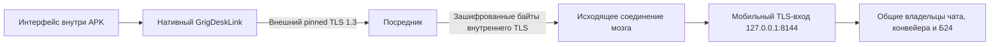

# Архитектура приложения на телефоне

`mobile/` содержит отдельный Vue/Pinia-интерфейс и нативный плагин Capacitor
`GrigDeskLink`. Интерфейс поставляется внутри APK. Он не загружается с посредника
и не импортирует продуктовые модули `web/`, `server/` или `shared/`.

Основной GrigDesk слушает HTTP на `127.0.0.1:<GRIGDESK_PORT>`, по умолчанию 8140.
Мобильный вход — отдельный TLS-сервер на IPv4 loopback, по умолчанию 8144; он отдаёт
только `/api/mobile/v1`. Его отказ не мешает запуску основного сервера:
[изоляция запуска](../server/mobile-startup-isolation.md).

## Посредник

Первое прикладное сообщение внешнего TLS — одна строка UTF-8 JSON, не HTTP и не WebSocket.
Версия `v:1` и роль `brain`, `device` либо `health` выбирают назначение соединения.
Секреты ролей разные; строки ограничены 2048 байтами. Ответ `{"ok":true}` завершает
согласование. Остаток того же сетевого пакета сохраняется как начало туннеля.

Мозг держит управляющее исходящее соединение. Для телефона посредник запрашивает
отдельную пару; мозг соединяет её с собственным мобильным TLS-входом. После согласования
посредник передаёт байты с backpressure, не разбирая HTTP и внутренний TLS.
Закрытие одной стороны закрывает пару целиком. Лимиты, IP ban, supervisor и watchdog
принадлежат `relay/src/`; [контейнер и эксплуатация](relay-deploy.md).

## Личности и привязка

Личность мозга и сертификаты посредников сохраняются в приватном мобильном каталоге
GrigDesk. Перезапуск не создаёт новую личность. Телефон создаёт P256-ключ в Android
Keystore; закрытый ключ не экспортируется. Внутренний TLS предъявляет сертификат
телефона, а HTTP guard проверяет его SHA256-отпечаток по списку устройств.

Оба TLS-слоя используют точный SHA256 pin сертификата. Телефон проверяет pin посредника
до `hello`, pin мозга — до HTTP. Не нужен собственный CA в системном хранилище телефона.
Подробности жизненного цикла — [нативная безопасность](native-security.md).

QR — `grigdesklink:1:<канонический base64url JSON>`, не произвольный URL. Payload содержит
`v`, `brain:{name,fp}`, `relay:{id,name,host,port,fp,token}` и необязательный
`pair:{code,exp}`. Текст не больше 4096 байт; token — 32 случайных байта, code — 24.
Код первой привязки ограничен сроком действия. Повтор с тем же сертификатом восстанавливает
потерянное подтверждение, не добавляя второе устройство. QR без `pair` добавляет посредника
уже привязанному телефону. Другой мозг требует явной отвязки.

QR и `relay.env` содержат секреты. Их показывает или скачивает авторизованный владелец
через блок «Приложение на телефоне» в настройках GrigDesk; журналы их не содержат.
