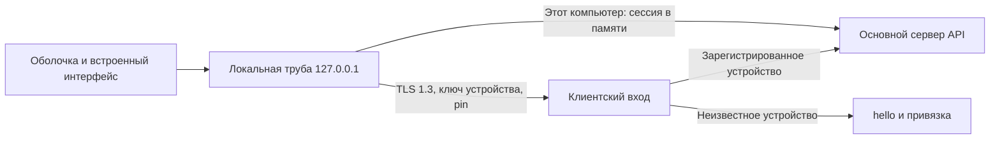

# Единое приложение

Linux и Android загружают один собранный интерфейс из своего пакета. Сервер отдаёт API,
снимки и защищённые страницы плагинов. Удалённая машина добавляется строкой или QR привязки;
смена адреса уже известной машины требует подтверждения её прежнего сертификата.

Каждый профиль имеет отдельный постоянный origin. Файлы интерфейса проверяются по
манифесту до первой загрузки. Cookie трубы не передаётся машине; ключ устройства не попадает
в renderer или WebView. Отпечаток сервера проверяется во время TLS до HTTP. Отзыв устройства
закрывает его открытые соединения на обоих входах.

Окно показывается после первого кадра независимо от сервера и VPN. Потеря связи сохраняет
документ и запускает повтор; ручное отключение и терминальные состояния останавливают
автоматику. Версия API проверяется на каждом ответе кроме upgrade: несовместимость закрывает
потоки и блокирует действия до нового подключения. До первого выпуска контракт остаётся 0.1,
пакеты Linux и Android — 0.1.0. Обновление приложения выполняется вручную.

Местную установку Linux запускает прежний supervisor. Удалённый профиль не запускает
местный сервер. На Android фон закрывает транспорт, поворот сохраняет документ, а
просроченный доступ к Keystore требует биометрию или код устройства.

Подробности: [труба](../web/client-pipe.md), [оболочка](../web/client-shell.md),
[клиентский вход](../server/client-listener.md), [привязка](../server/device-pairing.md),
[Android](../mobile/client-app.md), [границы проверок](../testing/unified-client-checks.md).

Прежнее приложение с посредником, модуль `:app` и `/api/mobile/v1` сохраняются отдельно.
Новый модуль `:client` использует тот же Android applicationId, не создавая третьего пакета.

На обеих платформах страница плагина удалённой машины в том же origin получает права окна.
В Electron проверки главного фрейма остаются дополнительным ограничением прямых вызовов,
но не обеспечивают изоляцию: iframe может вызвать top.fetch('/__shell/state'),
top.navigator.mediaDevices.getUserMedia(...), top.location= и window.open в главном контексте.
В Android fetch подфрейма также неотличим от fetch главного фрейма.
Sec-Fetch-Site и защита cookie ограничивают обращения с соседних портов; доверие странице
того же origin они не ограничивают. При старте ПК удаляются все прежние cookie для 127.0.0.1,
включая копии grigdesk_pipe с другими Path, затем устанавливается новый секрет.
Полная изоляция страниц плагинов удалённых машин требует отдельного плана владельца.
